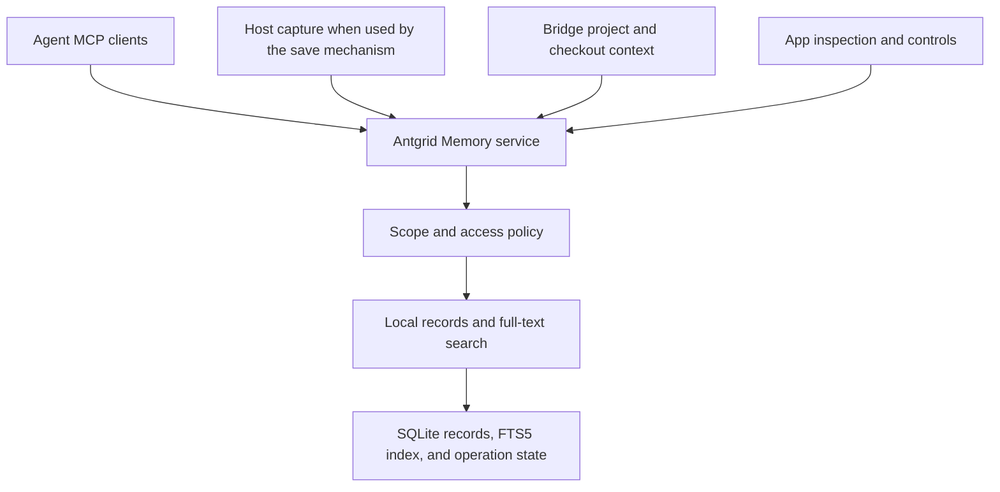

# Antgrid Memory architecture proposal

**Status:** Implemented locally; release qualification incomplete. Updated 2026-10-29. Storage, bridge authorization, the separate memory MCP server, and app inspection controls are implemented. The final hook trial passed automatic saving, cross-agent recall in both directions, reuse without duplication, correction/history, and forgetting with Claude Code and Codex. OpenCode 1.19.0 subsequently passed the same interactive sequence and bidirectional sharing with Claude. Codex saves were observed in exec mode and the normal terminal. Earlier trials exposed duplicate, scope-selection and tool-discovery failures; their evidence is retained below. The measured support matrix and remaining release gates are below. Semantic search, model-based reranking, general memory aging, and automatic memory injection remain outside v1.

Antgrid Memory will automatically save useful findings and let agents retrieve them across sessions on one machine. Start with a lightweight memory service backed by local records and full-text search; a third-party memory engine is not a prerequisite. Antgrid supplies project and task boundaries, provenance, and user controls. Alternative backends, Antgrid-hosted storage, and cross-machine sharing are future directions.

For example, the cause of a Windows build failure can be saved without the user asking to remember it. A later agent can retrieve that finding with its source and conditions, then verify whether it applies to the current work.

## Goals and boundaries

- Local cross-agent recall for project folders with or without Git, including non-coding work.
- Automatic saving of useful findings without per-memory user requests or approval, plus bounded search, inspection, correction, and deletion.
- Memory persistence independent of the originating session's lifecycle.
- Provenance and applicability without turning remembered choices into authoritative rules.

Saving runs automatically during normal use; users do not need to say "remember this" for each finding. Start the integration trial with agent-initiated `memory_save` and concise static guidance about what and when to save. Tool availability alone does not establish reliable automatic saving: measure useful findings saved and missed for every supported agent. Add host-specific capture/extraction only where the trial demonstrates that it is needed. Do not make transcript retention, extraction models, or a background queue prerequisites for the direct-save path. Automatic saving remains a release requirement, users can pause it, and explicit remember requests remain supported. Agent-driven and background writes have different latency and capture-quality tradeoffs; neither is universally required. [LangGraph memory writing](https://docs.langchain.com/oss/python/concepts/memory#writing-memories)

Recall is on demand in v1. Antgrid injects no saved memory at session start or automatically in response to a user prompt. Agents may invoke search/get when useful; tool descriptions and static usage guidance do not preload memory content.

Repository instructions and reviewed project documents remain authoritative. Memory is untrusted reference material and never grants command permissions or access to another project. Access control is enforced in code.

V1 stores memory records, indexes, and required operational/source data on the developer machine's local filesystem, in persistent database files outside disposable project checkouts. A hosted memory database is not required for v1. Search requires no model or embedding provider. Any model processing used for saving follows explicit configuration; local storage does not imply that the working agent or a capture/extraction path runs offline. Ordinary work must continue when memory is unavailable. Later releases may move persistence to an Antgrid-managed database or storage service; its server architecture and migration are deferred.

Agents keep their own memory. Claude Code auto memory and Codex memories continue to run beside Antgrid Memory; Antgrid neither disables, redirects, nor mirrors them. Instruction files (`CLAUDE.md`, `AGENTS.md`) stay out of memory because agents already load them.

Checkout isolation therefore covers Antgrid Memory only. With their default storage layouts and memory enabled, Claude Code shares auto memory across a repository's worktrees and Codex shares memory across sessions using the same Codex home. An isolated session can therefore record unfinished-work findings that other sessions may recall. Agents may receive Antgrid and native memories that disagree. The inspection UI shows provenance for memories Antgrid supplies or explicitly imports; it cannot promise visibility into native recall without host support.

## Comparable systems

| | Claude Code | Codex | Supermemory | Antgrid (this proposal) |
|---|---|---|---|---|
| Who writes | The agent, during the session | Background extraction/consolidation; the working agent writes explicit request notes | The server, from the session sent at session end | Trial agent-initiated automatic saves first; host capture only if needed; persisted records have durable IDs |
| Where | Local, per repository | Local, one folder per user | Hosted (or a closed local binary), per repository remote | Local, per project (Git optional); unfinished-work findings stay task- or checkout-scoped |
| Loaded at session start | Index, first 200 lines or 25 KB | Summary, 2,500 tokens | Up to 5 stable + 5 recent profile items | No saved memory content in v1; tools are available on demand |
| Recall during the session | Agent reads files | Agent searches files | Hook searches on every prompt | `memory_search` (bounded) and `memory_get` (full record with source) |
| Cross-agent | No built-in cross-vendor sharing | Claude Code memory import | Yes, through a shared authorized namespace on a hosted or local server | Yes, any supported agent on the same machine through MCP; cross-machine deferred |
| Forgetting | Manual | Consolidator is instructed to remove claims supported only by deleted sources | Automatic expiry and contradiction | Explicit deletion through `memory_forget`; task state expires after 30 days without a meaningful update |

**Claude Code** keeps a per-repository folder of typed files (`user`, `feedback`, `project`, `reference`) with a `MEMORY.md` index, written by the agent during work and shared across worktrees. The 2026-10-27 draft recorded one local Antgrid development sample: 110 of 139 typed entries were `project`, mostly status ledgers. This anecdotal sample motivates evaluating temporary-state retention; it does not establish that the type system caused the accumulation. [Memory documentation](https://code.claude.com/docs/en/memory)

**Codex** generates consolidated memory in the background. With the inspected defaults, transcripts at least 6 hours idle and at most 10 days old are eligible, with 2 processed per startup. Extraction can return no output when nothing merits retention; a consolidation agent then updates a git-tracked memory folder. Sessions with available memory receive a summary capped at 2,500 tokens. Citations of used memories feed a usage count, and memories unused for 30 days leave consolidation. Its newer pipeline drops the raw-memory records, handbook, and generated skills, keeping task-history summaries and prompting for one summary under 10 KB. The working agent persists explicit remember/correct/forget requests as inspectable notes; consolidation applies them later. Removing claims supported only by deleted sources is a consolidation prompt requirement, not an immediate deletion guarantee. Optionally, sessions that used web search or external tool output are excluded from extraction. Sources at [`50983c7`](https://github.com/openai/codex/tree/50983c7a9324f402f631cd9abfcd91d11baed5a2/codex-rs/memories): [pipeline README](https://github.com/openai/codex/blob/50983c7a9324f402f631cd9abfcd91d11baed5a2/codex-rs/memories/README.md), [extraction prompt](https://github.com/openai/codex/blob/50983c7a9324f402f631cd9abfcd91d11baed5a2/codex-rs/memories/write/templates/memories/stage_one_system_v2.md), [consolidation prompt](https://github.com/openai/codex/blob/50983c7a9324f402f631cd9abfcd91d11baed5a2/codex-rs/memories/write/templates/memories/consolidation_v2.md), [settings](https://github.com/openai/codex/blob/50983c7a9324f402f631cd9abfcd91d11baed5a2/codex-rs/config/src/types.rs), [Claude Code import](https://github.com/openai/codex/blob/50983c7a9324f402f631cd9abfcd91d11baed5a2/codex-rs/external-agent-migration/src/memory_import.rs).

**Supermemory** plugins for Claude Code, Codex, and OpenCode derive a shared namespace from the normalized Git remote. Agents and clones using the same backend and authorized namespace share its memories; the plugins can target a hosted or local server. Hooks load profile items at session start, search on every prompt of 12 or more characters, and send each session's new turns at session end; extraction happens on the configured server. The engine distinguishes documents from extracted memories, links memories by update, extension, and inference, and gives types different lifetimes. Sources at [`c2ffeec`](https://github.com/supermemoryai/claude-supermemory/tree/c2ffeecc2c8cd6aab1681567bf04681c5b027f30) and [`225fbf0`](https://github.com/supermemoryai/supermemory/tree/225fbf0e0cdd374f729011c73ec49ff6bd9c50ed): [extraction rules](https://github.com/supermemoryai/claude-supermemory/blob/c2ffeecc2c8cd6aab1681567bf04681c5b027f30/plugin/hooks/lib/api.js), [hooks](https://github.com/supermemoryai/claude-supermemory/blob/c2ffeecc2c8cd6aab1681567bf04681c5b027f30/plugin/hooks/hooks.json), [memory model](https://github.com/supermemoryai/supermemory/blob/225fbf0e0cdd374f729011c73ec49ff6bd9c50ed/apps/docs/concepts/graph-memory.mdx), [local server and plugin support](https://github.com/supermemoryai/supermemory/blob/225fbf0e0cdd374f729011c73ec49ff6bd9c50ed/apps/docs/self-hosting/overview.mdx).

**Mem0 Platform** documents additive extraction and hybrid retrieval. Its Dream feature merges duplicates and marks superseded facts while retaining history; synthesis is a separate opt-in capability. Default reads can include superseded facts, while `latest_only` selects active memories. These are Platform behaviors, not a guarantee that the OSS engine or every plugin has the same contract. Antgrid keeps correction history but excludes superseded records from normal recall, starts with exact-duplicate suppression, and defers synthesis. [Platform migration](https://docs.mem0.ai/migration/platform-v2-to-v3), [Dream behavior](https://docs.mem0.ai/platform/features/dream)

Supermemory distinguishes updates from extensions and inferred facts; Graphiti models temporal fact invalidation. These are useful references for preserving history and conditions, not proofs of Git merge equivalence or factual correctness. Observations under different environments can remain valid together. Antgrid does not need a relationship graph to preserve that distinction. [Supermemory graph memory](https://supermemory.ai/docs/concepts/graph-memory), [Graphiti overview](https://help.getzep.com/graphiti/getting-started/overview)

Local cross-agent sharing already exists in Supermemory, and the inspected Codex source includes a one-way import of Claude Code memory. Antgrid's proposed value is integration with its trusted project/task/checkout context, enforced retrieval boundaries, and inspection and correction in the app.

## Architecture and packaging



Implement an independently usable package in this repository, provisionally `packages/antgrid-memory`. Keep agent adapters thin and share retrieval formatting, scoping, and lifecycle behavior. The package must not import bridge internals; the bridge supplies trusted context through explicit interfaces. A future standalone MCP entry point should use the same service contract. Independent distribution and installation are deferred beyond v1.

Antgrid owns project identity, access boundaries, source attribution, retrieval budgets, and user controls. Agents supply concise findings through `memory_save`; the service need not run a second model to extract them again. The baseline has no capture pipeline. Background capture is a conditional extension for supported hosts whose measured save coverage is insufficient.

Use SQLite records and FTS5 as the proposed local backend. The memory service owns durable record IDs and implements updates, deletion, lifecycle checks, and export. The full-text index is derived from those records, not a second source of truth. Validate FTS5 availability and packaging in the shipped runtime on Windows, macOS, and Linux before fixing the integration.

Keep required source and operation state with the local store; a full duplicate memory store and general revision graph are not prerequisites. Export must preserve IDs, scopes, applicability, provenance, and lifecycle state so a future storage migration does not depend on copying machine-specific paths unchanged. Full-text indexes can be rebuilt from the records.

Keep the service contract independent of its storage backend. Define any internal adapter from the working integration; do not require an external engine trial, public provider API, engine picker, or mandatory consolidation method for v1.

## Memory model

| Field | Meaning |
|---|---|
| `id` | Durable memory identity owned by the service |
| `content` | Self-contained finding, preference, or note |
| `memory_type` | `preference`, `task_state`, `observation`, or `note` |
| `scope` | `user`, `project`, or `task`; visibility and permissions are separate |
| `project_id`, `task_id` | Applicable context where required by scope; v1 task bindings use an existing durable Antgrid session |
| `checkout_id` | Optional enforced restriction on a task-scoped implementation finding, checked against the caller's trusted checkout identity |
| `applicability` | Optional plain text preserving conditions and uncertainty |
| `source` | Originating actor/agent, conversation/session, and relevant checkout/document context |
| `evidence` | Optional supporting references: versioned file, message, or retained command result |
| `supersedes` | Optional ID of the memory this one corrects |
| Timestamps | Creation/update time; validation time only after an actual check |

For v1, bind task-scoped memory to an existing durable Antgrid session. `task_id` names that service binding, not a new task-management entity, a process run, or an agent-native conversation ID. Resuming the same Antgrid session retains its binding; starting an unrelated session does not inherit it. A native conversation records origin and may change without changing the owning Antgrid session. Grouping multiple Antgrid sessions into one task is deferred. Project-scoped findings remain available across authorized sessions and agents.

Defer `global` scope and `workspace_id` until their meaning is defined independently of project, organization, and checkout. User scope requires an explicitly bound local owner, never an implicit machine-wide namespace. The integration must select that stable owner identity before enabling user-scoped reads or writes.

The type defines the default lifecycle. Every type can be explicitly forgotten. V1 includes soft expiry for `task_state`; general memory aging is deferred:

| Type | Lifetime |
|---|---|
| `preference` | Kept until corrected or forgotten |
| `task_state` | Superseded when its state changes; excluded from normal recall after 30 days without a meaningful update; never promoted by age. No existing product action establishes task completion or cancellation in v1. |
| `observation` | Kept until superseded or forgotten |
| `note` | Kept until superseded or forgotten |

A `task_state` record requires task scope and a valid session-backed `task_id`. Existing bridge session and checkout records do not establish a general task completion/cancellation lifecycle. Before wiring immediate retirement, identify an explicit product action whose meaning is completion or cancellation; a turn ending, conversation ending, agent exiting, or checkout disappearing is insufficient. If no such action exists, retain unknown task status and apply inactivity expiry rather than inventing an event or building a task-management subsystem for memory. The binding and supported lifecycle actions must be documented by the integration trial. Existing identities: [session schema](../bridge/src/protocol.ts) and [checkout records](../bridge/src/worktrees/checkout-types.ts).

Task-state expiry removes the record from normal search and agent recall, including direct recall by ID, while retaining it for authorized history inspection until explicitly forgotten. The initial inactivity window is 30 days, evaluated from the record's last meaningful state update (`updated_at`, initialized at creation). Reads, indexing, bookkeeping, and activity elsewhere in the task do not refresh that timestamp. The window is an initial product default to revisit after the integration trial.

Evaluate task status and elapsed time when serving memory; no background expiry scheduler or model judgment is required. Resuming a task does not automatically reactivate old state. A resumed task can use inspected history to verify and save fresh state through the correction flow. The inactivity rule applies only to `task_state`; reusable observations and other memory types retain their own lifecycle and scope. Neither task completion nor expiry promotes any memory to project scope.

A correction creates a new memory that supersedes the old one. The superseded memory leaves normal recall but stays inspectable until explicitly forgotten. Replacement must be atomic and identify the latest revision: if another agent already corrected it, return a conflict for the caller to inspect. Latest revision and recall eligibility are separate. An expired latest revision can be inspected through authorized history and corrected after verification; a completed or cancelled task must first be explicitly resumed, and forgotten content cannot be refreshed by retry. Corrections preserve access and checkout restrictions. This retains simple correction history without requiring a general revision graph.

In-place scope promotion and its dedicated operation are deferred. When new evidence establishes a reusable project finding, an authorized agent may save a separate project-scoped record with its own conditions and evidence. That is a new finding, not a widening correction or an automatic copy of task state. It requires no decision-approval workflow.

There is no `observed_environment` field or fixed OS/library compatibility schema:

```json
{
  "memory_type": "observation",
  "scope": "project",
  "project_id": "project_123",
  "content": "Library X failed to initialize when condition Y occurred.",
  "applicability": "Observed on Windows with library X 2.4.1; other platforms and versions are unverified."
}
```

Always index, retrieve, and consolidate content together with applicability. Missing conditions mean unspecified applicability, not universal validity. Plain text supports agent judgment, not deterministic version filtering. Add structured fields only when evaluations establish a need.

Evidence supports a claim; source records where it was captured. File references should retain versions or hashes when available, since line numbers move. Show when evidence becomes unavailable. Avoid retaining full transcripts solely to support a short finding.

## Project and checkout applicability

Use stable local project identity with explicit local bindings. Git remotes may suggest related checkouts but are not authorization. Git is optional evidence, not the definition of a project.

Implementation-dependent findings from unfinished work use task scope and, where a checkout exists, a `checkout_id` restriction in Antgrid Memory; agents' native memory is outside this guarantee (see Goals and boundaries). Task scope requires a project/task binding validated by the service. Enforce scope and checkout restrictions on search and agent `memory_get`, as well as on mutations. Any future automatic recall must apply the same restrictions. Matching a task binding alone cannot satisfy a different checkout restriction. Missing caller context cannot satisfy a restriction. Authorized history inspection is separate from normal agent recall.

For agent tool calls, the bridge verifies the session and its live run, then derives project, task binding, checkout, owner, and captured source attribution. Agent-provided identifiers do not grant access or prove authorship. Reuse the identity-validation pattern in [resolveSchedulerCaller](../bridge/src/scheduler-caller.ts); checkout routing by a claimed terminal ID alone is insufficient. Memory requests must not inherit the generic loopback route's fallback to the main checkout when identity is missing. User inspection uses its separately authorized app context. The memory package accepts verified host context without importing bridge internals; a standalone host must provide equivalent bindings when that packaging is introduced.

Independent lessons may be saved at project scope with conditions. Branch names and commit IDs are provenance; neither alone proves current validity. An origin checkout in `source` records where a finding was captured, while `checkout_id` restricts where it can be recalled.

V1 uses conservative scope, explicit correction, and separately verified project findings. Do not broaden a finding because a branch disappeared, was renamed, or another session repeated it. Unknown compatibility remains unknown. Automatic squash/rebase/cherry-pick equivalence is deferred.

For non-coding work, exploratory drafts and proposals likewise do not become approved project facts. Document/version evidence does not require a full approval subsystem.

## What to save

Save only what would make a future agent act better: the test is whether the next agent would plausibly do something differently because of it. Saving nothing is the expected outcome for most sessions.

Save:

- How the user wants to work, especially what they had to repeat, correct, or interrupt to enforce.
- Failure lessons as symptom, cause, and fix, with the conditions they were observed under.
- Where the truth lives: entry points, configuration, exact commands, and error strings that took effort to find.
- Reusable rationale for decisions, worded as proposed, accepted, attempted, or observed.
- Task-scoped handoff context that cannot be recovered cheaply from current sources: unresolved questions, attempted approaches, and the next intended step, stored as `task_state`.

Do not save:

- Working-tree state that Git already records: uncommitted files, branch position, push or PR status.
- Copies of readily available source content. Retain concise pointers and hard-won findings when they save meaningful investigation; consult the owning source for current truth.
- Live values that should be queried again. Useful temporary handoff context belongs in `task_state`, with its task lifecycle.
- Generic advice, large outputs, credentials, and assistant proposals the user did not adopt.

Attribute rather than generalize. A single request is recorded as what the user asked for in that task ("the user asked to see a plan before editing"), not as a standing preference. It becomes a `preference` only when the user states it as a default or it recurs across distinct tasks. An agent's conclusion is not proof of team approval or implementation success. Reference authoritative documents when available; no decision-approval workflow is required for v1.

Keep temporary task state in `task_state`, separate from durable project knowledge.

Memory maintenance must preserve attribution and conditions. It must not broaden scope, infer approval from repetition, infer facts nobody stated, or merge incompatible findings into a universal claim. A custom dreaming scheduler is deferred.

### Duplicate findings and corrections

Operation idempotency prevents transport retries from creating duplicates; it does not handle two agents independently saving the same knowledge. On creation, suppress an exact duplicate of an eligible latest record with the same owner, effective scope, task/checkout restrictions, memory type, content, and applicability. Compare validated text exactly; do not use fuzzy matching or normalization that can erase meaningful differences. Check the caller's access before returning an existing ID and make duplicate detection and receipt creation atomic so concurrent saves cannot create two copies.

Return the existing ID with an `already_present` outcome and consume the new operation key. Preserve the original attribution, evidence, and timestamps: repetition does not extend expiry, count as independent corroboration, or validate the finding. Different evidence can motivate an explicit correction after inspection; it is not silently merged. Expired, superseded, and forgotten records are not active duplicate targets, and this path does not reactivate them. Exact-duplicate handling does not detect paraphrases.

When an agent knows new evidence replaces an existing finding, it should inspect that record and use the correction flow rather than save a competing current claim. A different OS/version or other applicability condition does not by itself invalidate the older observation. Automatic semantic merging and contradiction resolution are deferred; evaluate duplicate and contradictory recall explicitly.

## Agent interface and lifecycle

- `memory_search`: bounded full-text retrieval within authorized context, using built-in relevance ranking.
- `memory_get`: inspect a memory and its source/evidence.
- `memory_save`: create or atomically correct a memory, whether initiated automatically or requested by the user, or return an eligible exact duplicate as `already_present`. Commit required record/index changes and the operation receipt together before returning a durable ID; subsequent authorized reads and matching searches can see the committed record, subject to its lifecycle and normal result limits.
- `memory_forget`: delete the addressed memory and its retained correction history, remove derived retrieval state, and suppress related pending work. Retirement and supersession only remove normal recall; forgetting also removes inspection content.

An addressable record with immediate readback and defined mutation behavior is deliberate. Codex persists inspectable request notes immediately and applies them during later consolidation; its working agent is instructed to avoid editing generated memory directly. The inspected Mem0 coding plugin instead restates the request for later extraction without a direct saved-record confirmation. Antgrid's direct save operation confirms a persisted record or identifies an existing exact duplicate. Automatically captured events awaiting extraction are pending inputs, not saved memories; expose that distinction and the resulting record IDs when available. Explicit user remember requests must not silently disappear through an extraction no-op. Sources: Codex [request instructions](https://github.com/openai/codex/blob/50983c7a9324f402f631cd9abfcd91d11baed5a2/codex-rs/ext/memories/templates/memories/read_path_v2.md) and [note persistence](https://github.com/openai/codex/blob/50983c7a9324f402f631cd9abfcd91d11baed5a2/codex-rs/ext/memories/src/local/ad_hoc_note.rs); Mem0 [remember skill at the inspected revision](https://github.com/mem0ai/mem0/blob/2c81af3bbe27d9bccb09c772d583df9e9be72ee5/integrations/agent-plugin-core/skills/remember/SKILL.md.tmpl).

Provide inspect/edit/forget controls, automatic-saving pause/resume, and pending-work status for capture or cleanup where used. Forgetting must immediately exclude affected records from service responses, including direct reads, and complete removal from canonical storage, derived summaries/indexes, adapter retry payloads, and Antgrid-owned evidence copies retained solely for those records. Report pending or failed cleanup rather than confirming completed deletion prematurely. References to external files or original conversations do not authorize deleting those sources. Suppress replay of affected queued capture and consumed save operations, including operations that returned `already_present`, so they cannot recreate the forgotten content. This is suppression of known work, not a promise to recognize every future paraphrase of the claim or erase agents' native memory or already-injected conversation context.

V1 returns memory content only through requested search/get operations or user inspection. Bound search results by both count and response size, and fetch details on demand. Session-start injection, first-prompt recall, and per-prompt recall hooks are deferred. Directory filtering is useful for monorepos but is not an authorization boundary.

Automatic saving must follow the evidence and retention rules above and be inspectable. It does not require saving every conversation or every turn. Normalize inputs per host rather than assuming identical hooks or agent behavior. If measured misses require a background capture/extraction path, persist its work before processing, recover interrupted batches, bound tool evidence, and specify batching, compaction, session-end, and retry behavior. Those requirements apply to that extension, not to every direct save. Redact credential-shaped values before retaining write or retry payloads, and expose failures without blocking sessions. Redaction does not guarantee the absence of sensitive content. Treat external tool output and recalled memories as attributed source data; repetition of retrieved memory is not new independent evidence.

### Record and response limits

These are initial product defaults to validate with representative memories, not guarantees of a fixed token count. Measure text fields in UTF-8 bytes and complete records/responses as serialized JSON, including metadata and the response envelope where applicable. One KiB is 1,024 bytes.

| Item | V1 limit |
|---|---|
| Memory `content` | 4 KiB |
| `applicability` | 1 KiB |
| Complete record, including metadata | 16 KiB |
| Evidence references | 8, within the complete-record limit |
| Search query | 1 KiB |
| Search results | 5 by default; maximum 10 |
| Search content per result | Complete content when it fits the response budget; otherwise an excerpt of up to 512 bytes |
| Complete search response | 8 KiB |
| `memory_get` | One complete record; no automatic expansion of correction history or referenced sources |

Reject oversized saves or queries with a validation error naming the field, actual size, and limit. Never silently truncate saved content or applicability. The caller can shorten the text or split independent findings into separate records; do not split a finding away from conditions needed to interpret it.

Reserve response space for IDs, scope, full applicability, compact provenance, and bounded content excerpts for the selected ranked matches. Use remaining space to return complete content in rank order when it fits, avoiding a second tool call for small findings. Mark whether each result's content is complete or excerpted; complete content does not imply that all record metadata or evidence is included. Truncate excerpts only at valid text boundaries. An agent must fetch full content before relying on an incomplete finding, since omitted text may qualify it. Return fewer results when necessary; the byte budget takes precedence over the requested count. Include `has_more` when further eligible matches were omitted because of count or size limits. Full records and evidence references remain available through `memory_get`. Evaluate complete-content delivery against excerpt-only delivery for extra tool calls, latency, total tokens, and answer quality.

### Save retries and idempotency

Each logical save requires an operation key created by the adapter before its first attempt; the model does not generate or manage these keys. The adapter retains the key and validated/redacted payload durably before dispatch so interrupted operations can be retried after reconnect or restart. Use a stable host tool-call identity when available to recognize a replay; do not infer operation identity from matching text or a new transport request ID. A genuinely new model invocation or correction gets a new key, with exact-duplicate handling separately covering repeated findings. If a host cannot distinguish a replay from a new invocation, do not claim cross-invocation exactly-once behavior; document that boundary in the integration trial.

Namespace operation keys by a stable, host-verified owner and caller binding, not an ephemeral process/run ID. Bind each receipt to the effective scope and canonical request payload, including any correction target. Verify the current caller and authorization on every attempt, including replay; a stable receipt identity does not authorize a resumed run. The adapter reuses its retained payload rather than regenerating it. Server-generated timestamps are not part of the caller payload, and replay must not recompute them as a new write.

| Situation | Required behavior |
|---|---|
| Same operation key and payload with an existing receipt | Return the original memory ID without another write |
| Same key with a different payload or effective scope | Return an idempotency conflict |
| Concurrent copies of the same operation | Commit once; resolve both attempts to the same ID |
| Different operations correcting the same latest revision | First correction succeeds; the other receives a correction conflict |
| A new create operation exactly duplicates an eligible record | Return its existing ID as `already_present`, without updating the record |
| Retry after forgetting the record | Refuse recreation; the consumed operation remains consumed |

Persist the receipt in the same transaction as the memory and its index changes. Receipts survive process restarts. A replay must not refresh `updated_at`, extend task-state expiry, add evidence, or reactivate a retired or superseded record. Return operation identity and permitted current lifecycle information rather than replaying cached memory content around current read restrictions.

After forgetting, retain only a minimal consumed-key marker needed to reject delayed replay, without the deleted memory body or its request payload. Clear resolved adapter retry payloads; retain consumed identity for delayed replays. Receipt cleanup must not turn a consumed key into a fresh save. This local replay guard does not require the deferred cross-machine conflict/tombstone protocol. Idempotency handles retries; exact-duplicate suppression handles a narrower subset of independent findings, without semantic deduplication.

For transient lock or connection failures, allow at most three attempts total within a two-second overall deadline, with asynchronous backoff and the same operation key. Avoid long synchronous database waits on the bridge event loop. Validation errors, permission refusals, and correction/idempotency conflicts require resolution rather than blind retry. A timeout may leave the commit outcome unknown; report that distinction and preserve the key for a later retry. Do not report a save as successful or definitively absent without evidence of that outcome. Background capture job scheduling, if used, is separate from this per-save retry budget.

### Transactional indexing and recovery

V1 has no normal per-record `pending_index` state. Update canonical records, the FTS5 index, and the operation receipt in one SQLite transaction, using maintained write statements or triggers for index synchronization. Return success only after commit; roll back the whole save on an indexing failure. Corrections and deletion must preserve record/index consistency as well. New read transactions after commit see the committed state; an already-running read may retain its earlier snapshot. [SQLite isolation](https://sqlite.org/isolation.html) and [FTS5 index synchronization](https://sqlite.org/fts5.html#external_content_tables)

Index corruption or rebuilding is service health, not an ordinary saved-memory lifecycle. Return an explicit `search_unavailable` or `rebuilding` status rather than an empty result implying that no memories match. Keep canonical records for recovery; direct reads can remain available when those records are readable and authorization permits them. Do not acknowledge saves that cannot commit their index changes. Repair must rebuild derived state without discarding saved memories.

Captured events awaiting extraction remain pending capture jobs. They become saved memories only when the save transaction commits. Asynchronous semantic indexing and any associated per-record status belong to a future design.

## Full-text retrieval

V1 uses full-text search only. Index memory content together with applicability. Use FTS5's built-in BM25 ranking with default column weights and an explicit ascending `ORDER BY rank`; without an ordering clause, results are arbitrary. Keep a deterministic tie-breaker. BM25 scores express lexical relevance, not confidence that a memory is true or applicable. No embedding model, vector index, cross-encoder, or LLM reranker is required. [SQLite FTS5 ranking](https://www.sqlite.org/fts5.html#sorting_by_auxiliary_function_results)

Apply trusted scope/checkout restrictions and lifecycle eligibility before the result limit, so inaccessible, superseded, or retired records cannot displace eligible matches. Return complete content or marked excerpts within the response budget, together with applicability, durable IDs, and provenance; fetch full details on demand. Preserve the same checks on direct reads. Do not use ranking weights as access control or add recency/popularity boosts before evaluation shows a need.

Expose a plain-text query interface and construct bounded, escaped full-text queries using parameter binding; SQL binding alone does not make arbitrary text safe as FTS query syntax. Define term and phrase behavior explicitly. Start with Unicode-aware tokenization and validate paths, punctuated identifiers, error codes, and original-language terms; full-text phrase matching does not guarantee byte-for-byte identifier matching. Preserve originals in the records. Agents should use concise search terms and may reformulate with alternate terms when a search misses; no separate model rewrites queries in the service. [SQLite query syntax](https://www.sqlite.org/fts5.html#full_text_query_syntax) and [tokenizers](https://www.sqlite.org/fts5.html#tokenizers)

Full-text search may miss paraphrases or translations without shared terms. A reranker only reorders retrieved candidates and does not solve those misses. Evaluate relevant matches in the first few results, missed findings, irrelevant results, and latency on representative coding and non-coding tasks. Revisit semantic retrieval or reranking only when measured failures justify their cost.

## Existing engines and future options

A separate memory engine may become useful for extraction or maintenance, but selecting one is not a v1 gate. Compare a future integration against the local service for Windows/macOS/Linux packaging, persistence, scoping, capture fidelity, deletion, export, latency, and total cost.

Mem0's coding plugins at the inspected revision call Mem0 Platform APIs; their local evidence SQLite database is not a local extracted-memory engine, and a base-URL override does not establish Mem0 OSS compatibility. Their shared runtime and thin host adapters are useful integration references, but MCP availability alone does not reproduce native capture hooks. Sources at [`2c81af3`](https://github.com/mem0ai/mem0/tree/2c81af3bbe27d9bccb09c772d583df9e9be72ee5/integrations): [memory core](https://github.com/mem0ai/mem0/blob/2c81af3bbe27d9bccb09c772d583df9e9be72ee5/integrations/agent-plugin-core/python/memory_core.py), [host capabilities](https://github.com/mem0ai/mem0/blob/2c81af3bbe27d9bccb09c772d583df9e9be72ee5/integrations/agent-plugin-core/README.md). Hosted extraction quality and local-backend compatibility were not evaluated.

Supermemory is not a candidate default engine. Its server is closed source: the self-hosted binary is free within an unstated licence limit, and native builds cover macOS and Linux, with native Windows held at an older release and newer releases needing Linux containers. [Self-hosting overview](https://github.com/supermemoryai/supermemory/blob/225fbf0e0cdd374f729011c73ec49ff6bd9c50ed/apps/docs/self-hosting/overview.mdx), [Docker setup](https://github.com/supermemoryai/supermemory/blob/225fbf0e0cdd374f729011c73ec49ff6bd9c50ed/apps/docs/self-hosting/docker.mdx). It could become an optional external connector later.

Codex's memory pipeline is built into the Codex CLI rather than offered as an engine; it is a design reference for idle-time extraction, consolidation, and usage-based expiry.

Graphiti and Claude-Mem remain possible future alternatives, not selected dependencies. Verify actual local operation and integration requirements before adopting any engine.

## Delivery and validation

1. Bind temporary memory to existing durable sessions, verify caller identity and checkout restrictions, and settle the local owner identity. Trial agent-initiated automatic saving with direct save/search/get/forget operations, SQLite/FTS5 persistence and ranking, and project/task isolation. Settle query handling, adapter retry ownership, transactional record/index/receipt integration, and export before fixing the internal storage contract.
2. Integrate supported agents and app inspection/correction and pause/resume controls. Verify that useful findings are saved without a user remember request and can be retrieved by another agent on the same machine. Measure save coverage and add host-specific capture only where demonstrated misses justify it.
3. Validate saving quality, on-demand cross-agent reuse, failure recovery, and the controls before the initial release. Automatic memory injection and Antgrid-hosted persistence remain later work.

Measure task completion, repeated investigation avoided, useful findings saved or missed, unnecessary or incorrect saves, duplicate or contradictory recall, stale recall, latency, extra tool calls, and total tokens/cost including extraction and maintenance. Initial-release scenarios include an automatically saved reusable fix, unrelated sessions and incompatible checkouts, conflicting environmental conditions, non-Git folder, proposed decision, missing evidence, deletion with pending work and retained correction history, concurrent corrections, and a resumed durable session after its earlier agent run ends. Verify restrictions on direct reads as well as search, refusal of missing/spoofed/stale caller bindings, and isolation between user-memory owners. Verify that startup and prompt submission do not inject saved memory. Validate interrupted processing, pause/resume, extraction from sessions that ingested external content, and preventing recalled context from being saved again as fresh evidence where those paths are used.

Task-state lifecycle checks cover immediate retirement where an explicit completion/cancellation action is supported, unknown task status when no such event exists, exclusion at the 30-day boundary, repeated reads or duplicate saves that do not extend the window, and resumed tasks requiring verified fresh state. Verify that an expired latest revision can be corrected, while correcting an already superseded revision conflicts. Expired records remain inspectable, and task completion/expiry neither retires other memory types solely because of their task origin nor broadens their scope.

Run a multi-session sequence as well as isolated operation checks: one agent saves a reusable finding, another repeats it, new evidence corrects it, and subsequent recall returns the current finding once. In a resumed session, inspect and refresh expired task state without widening its scope. Finally forget the records and replay old operations, including duplicate-save receipts, to verify that no content returns. Repeat with different applicability and owners to verify that distinct findings are not collapsed.

Retrieval checks cover built-in relevance ordering, limits applied to eligible records, punctuated search inputs, representative identifiers and original-language terms, applicability retained in snippets, and index consistency after corrections/deletions or interrupted work. Record lexical misses as such; do not claim semantic matching or add a reranker to conceal missing candidates.

Limit and retry checks cover UTF-8 and JSON-escaping boundaries, oversized content/applicability/evidence, count-versus-byte limits, complete-versus-excerpt content markers and `has_more`, and complete single-record reads. Simulate a committed save with a lost response, concurrent duplicate requests and independent identical saves, changed-payload conflicts, adapter and service restarts, retries after forgetting, authorization changes before replay, and retries that must not extend task-state expiry. Verify all-or-nothing record/index/receipt updates, bounded transient retries, explicit unknown outcomes, and repair failures distinguished from empty search results.

## Deferred work and open questions

Semantic search and embedding models, vector indexes, model-based reranking, automatic semantic merging and contradiction resolution, general memory aging, native-agent memory import, standalone distribution, automatic memory injection, Antgrid-hosted persistence and storage migration, cross-machine replication, distributed conflicts/tombstones, public engine plugins, an engine picker, automatic Git merge equivalence, structured environment matching, grouping multiple Antgrid sessions into a task, in-place scope promotion, decision approval workflows, inferred memories, and custom dreaming are outside v1. Standalone host bindings and installation/lifecycle behavior belong to the later packaging design; the v1 package keeps explicit interfaces for that future use.

Future storage may use Antgrid's web database or a dedicated server-side store. The choice, migration, and server authorization model need a separate design when scheduled. Off-machine Antgrid payloads must use authenticated Iroh connections and existing authorization boundaries; the control relay must never carry memory payloads.

## Resolved implementation choices

`packages/antgrid-memory` owns Zod contracts, a versioned SQLite database, FTS5,
access filtering, correction history, operation receipts, redacted pending saves,
settings, and versioned JSON export. It imports no bridge internals.
`bridge/src/memory.ts` binds one lazily initialized service to each host. The
database is `<ANTGRID_DIR>/memory/memory.sqlite`; its profile row creates and
retains the local owner UUID independently of account sign-in. Opening or
migrating an unreadable store fails visibly and never replaces it with an empty
database. Initialization failure does not prevent sessions from starting.

Memory starts disabled. One app enablement applies to the local profile; a
project screen may perform that one-time enablement too. Profile pause blocks
every agent save. Project pause blocks every save originating in that project,
including user-scoped saves and explicit remember requests. Reads, forgetting,
and app corrections remain available while paused. Profile controls live in
machine Memory; project controls live in project Memory.

The host resolves each terminal tool call from its project core, durable
session, current checkout, launch-time agent identity, and live run secret.
Missing, stale, archived, command-only, or mismatched callers are refused. Run
secrets are never retained in records, pending payloads, receipts, or exports.
Task identity is the durable Antgrid session: resume preserves it; forks and new
sessions receive different bindings. Agent exit, turn end, archive, session
deletion, and project removal do not retire or forget memory. V1 implements only
the exact 30-day inactivity expiry for `task_state`.

`antgrid-bridge memory-mcp` is a separate stdio server named `antgrid-memory`.
Its four tools call the originating core's loopback `/memory/*` routes; it never
opens a second canonical database. Existing terminal MCP profiles add it beside
`antgrid`. Chat launches still skip MCP. Static save guidance lives in this
server's instructions and tool descriptions. Codex also receives the fixed
usage guidance through its existing `SessionStart` hook, including startup,
resume, clear, compact and fork events. OpenCode receives the same fixed text
through its terminal plugin's `experimental.chat.system.transform`, with
settings checked before each model request. No repository instructions are
edited and no saved content is injected. Native agent memory is unchanged.

Both adapters call `/memory/bootstrap` using only the inherited API port,
durable session and live-run identity. The bridge uses the same caller
authorization as memory tools, then returns only availability, opt-in, profile
pause and project pause flags. Disabled, paused, unavailable or malformed
responses produce no guidance. Requests refuse redirects and have a 1.5-second
deadline and 1 KiB response cap. Provider output is fixed local text, never
bridge-supplied instructions, records, source identifiers or transcripts.
Pausing during an existing Codex session still blocks saves in the service;
already delivered guidance cannot be removed from its conversation.

This is a targeted extension to the original MCP-only trial after Codex failed
to discover the deferred memory tools. It supplies static tool-use policy,
not automatic recall or background extraction. OpenCode's custom
`OPENCODE_CONFIG` bypass still suppresses Antgrid's plugin injection, preserving
the existing user-configuration precedence. Chat mode remains deferred.

The MCP adapter creates UUID operation keys and asks the host to durably prepare
the validated, redacted payload before dispatch. This host-owned adapter queue
lets forgetting suppress retries even while the child MCP process is absent.
On restart, recovery revalidates a live caller for the same durable session;
each retry rechecks authorization, scope, and pause state. A lost reply is an
unknown outcome, not proof of failure. Resolved payloads are removed; terminal
correction conflicts retain a content-free outcome. Forgotten operations keep
only their consumed binding/key marker. The clients do not provide a stable
cross-process tool-call identity, so a new model invocation cannot be promised
exactly-once behavior; independent exact duplicates are handled separately.

Writes serialize in the service and use SQLite immediate transactions, WAL,
short lock waits, and asynchronous bounded retries. Records, FTS, and receipts
commit or roll back together. Search uses `unicode61`, default BM25 weights,
ascending rank, and memory ID as the tie-breaker. Unquoted tokens are alternatives;
quoted groups are phrases. Caller operators have no special meaning. Scope and
lifecycle filters precede the result limit. The shared formatter preserves full
applicability and budgets the JSON result plus the MCP text envelope and an RPC
allowance within 8 KiB.

Forgetting removes the full correction chain, FTS entries, associated pending
payloads, and save/duplicate receipts' content-derived fields in one transaction.
Secure deletion and WAL checkpoint cleanup follow. A blocked checkpoint reports
`CLEANUP_FAILED` while all service reads already exclude the forgotten content;
machine Memory can retry cleanup. This is local storage cleanup, not a promise
to erase filesystem backups, external source files, native agent memory, or
previously delivered conversation content.

The app's project Memory uses admitted project payload streams; machine Memory
uses authenticated native machine RPC or the local owner's token-protected
control listener. Neither path carries memory over the control relay. Project
inspection sees its project/task records; machine inspection also sees user
records and histories whose projects or sessions were removed. Corrections
retain scope and checkout restrictions. Export is JSON version 1 with IDs,
records, provenance, applicability, links, and derived lifecycle state; it
excludes operational retry payloads and credentials. Import remains deferred.

## Qualification recorded on 2026-10-28

| Target | Evidence | Verdict |
| --- | --- | --- |
| Local storage and isolation | `bun run --filter antgrid-memory test` exercises duplicates, corrections, rollback, restarts, expiry, filtering, limits, index repair, cleanup failure, and replay suppression | Passed 26 tests and package typecheck |
| Bridge admission and app transport | Bridge memory caller, API, host, protocol, native authorization, and diagnostic suites | Passed 86 focused tests and bridge typecheck; authorization checked again on retry |
| Authenticated native end-to-end flow | `bun run --filter antgrid-evals test:evals:memory` uses a disposable real bridge and Iroh peers | Passed isolation, paused app edits, history/export, relay outage, restart/reconnect, and forgotten-operation replay |
| Flutter inspection controls | Focused Memory widget/service tests and `flutter analyze --no-pub` | Passed 15 tests and clean analysis; compact and desktop preview inspected with mock records, without a real account or host |
| Terminal profiles and MCP retries | `antgrid-agents` suites and bridge memory MCP tests | Passed 326 adapter tests, 15 MCP tests, and adapter typecheck; separate server registered without changing chat or native memory |
| Windows compiled MCP + SQLite/FTS5 | `bridge/scripts/memory-mcp-smoke.ts`, compiled with Bun 1.3.14, executed on Windows | Passed tool table, full-text search, persistence/restart, correction, forgetting, and old-operation replay |
| macOS/Linux compiled packaging | Same smoke harness is portable but has not run here | Unqualified |
| Claude Code 2.1.312 automatic saving | Authenticated real Antgrid terminal sessions, print mode, default `claude-opus-5-5`, isolated non-Git fixtures and native homes | Two ordinary-work runs saved source-backed findings without a remember request; full cross-agent sequence remains incomplete |
| Codex CLI 0.164.0 automatic saving | Authenticated real Antgrid terminal sessions, default `gpt-6.1-sol`; fresh exec and normal interactive runs | Both fresh-store ordinary-work runs completed without saving; automatic-save gate failed |
| Live duplicate, forget, and restart replay | Claude MCP forgetting plus explicit local verification scripts in the original durable session using inherited live caller identity | Exact duplicate returned `already_present`; original and duplicate operation replays returned `FORGOTTEN` after deletion; history remained empty |

The repeatable non-Git fixture, scenario prompts, required metrics, and execution
procedure are in [agent-memory-qualification.md](agent-memory-qualification.md).
The sanitized [live results](agent-memory-qualification-results.json) record
per-scenario outcomes, tool calls, wall time, native token usage and cache
counters. Claude's two automatic saves took 36.056 s and 30.581 s end to end;
their memory-save calls took 26 ms and 31 ms. Codex's fresh exec and interactive
tasks took 22.255 s and 25.834 s respectively, with no saved record. These are
individual observations, not latency distributions. Actual charges and extra
tokens/tool calls attributable to memory remain unknown without a baseline.
Missing measurements remain null, not zero.

The clean reverse sequence could not qualify cross-agent retrieval because
Codex had not created an eligible record. Its later correction task edited the
source guide instead of the saved memory; the prompt's reference to a prior
finding was ambiguous about which artifact to correct. Claude subsequently
found and forgot the memory. Explicit duplicate and replay scripts qualify
bridge behavior, not spontaneous agent tool selection. Live controls used the
authenticated desktop-owner transport; the Flutter UI was not driven against
these records. The remaining full sequence, live pause/fork/checkout scenarios,
and app-connected agent walkthrough remain open.

A credential-free local Responses diagnostic confirmed that Codex exec honors
the injected MCP configuration and connects the memory server. Its initial
model request contains neither the memory tool names nor the automatic-save
guidance. Both become available through the deferred runtime tool catalog. The
ordinary exec runs did not discover them. The normal interactive terminal also
missed the save, but its initial request exposure was not captured separately.

The hook follow-up below presents fixed tool guidance through the supported
Codex lifecycle mechanism. It does not toggle client features, inject saved
content, add repository instructions, or capture transcripts for a background
extractor. The original MCP-only failure remains evidence about discovery, not
a claim that the tools or database were unavailable.

The full bridge run also exposed a scheduler teardown failure outside this
change: the `scheduler-agent` test's temporary project can be reopened by an
asynchronous dispatch after host shutdown. The affected memory/transport suites
pass, but the full suite is not a clean gate until that scheduler race is fixed.
The isolated dense terminal-history test passed after timing out under the full
concurrent test load. These results do not qualify automatic agent saving.

## Hook follow-up recorded on 2026-10-29

Codex's supported [`SessionStart` output](https://learn.chatgpt.com/docs/hooks)
now carries the static policy before tool discovery. OpenCode's pinned
[`experimental.chat.system.transform` contract](https://github.com/anomalyco/opencode/blob/v1.15.10/packages/plugin/src/index.ts)
provides the equivalent terminal integration. Both use the authorized narrow
bootstrap described above; neither retrieves memory content. The sanitized
[hook qualification results](agent-memory-hook-qualification-results.json)
retain every policy trial and individual measurement, separate from the
original MCP-only report. Report timestamps use UTC; this section uses the
local qualification date.

The first hook trial made a source-backed Codex project save in exec mode in
40.434 s, and Claude recalled it in 23.402 s. Its repeat task saved a redundant
paraphrase without searching. Both resulting chains were corrected and forgotten;
the original Codex operation was refused as `FORGOTTEN` after host restart and
resume of its durable session. This verifies deletion protection independently
of the model's duplicate-avoidance mistake.

The second trial added search-before-save guidance. The normal Codex terminal
saved at task scope, making that otherwise reusable finding inaccessible to
later sessions by design. The repeat searched but could not see the earlier
task record. A later forget request failed to discover tools despite receiving
the hook, leaving an eligible project correction intact. These were scope and
tool-use failures, not authorization or search-index failures.

The final policy names all four tools, distinguishes tool discovery from MCP
resource listings, and explicitly chooses project scope for reusable project
findings while reserving task scope for temporary or unfinished work. It also
requires checking existing findings before a save; the MCP instructions and
save description carry those scope and reuse rules. This does not add semantic
deduplication: exact duplicate suppression remains the deterministic guarantee.

With that final policy, the unchanged five-stage sequence passed: Codex's
normal terminal automatically saved a project finding (38.863 s), Claude
recalled it (24.630 s), a fresh Codex session reused it without a duplicate
(33.965 s), Codex corrected it with `supersedes` while retaining history
(35.020 s), and Codex forgot the complete chain with successful cleanup
(27.939 s). Forgetting recovered from one invalid search-limit call. These
timings include startup and ordinary task work, not just memory overhead.
The reverse direction also passed in a fresh profile: Claude automatically
saved a project finding (32.993 s), then Codex recalled that exact record
without creating another (36.329 s).

| Target | Evidence | Verdict |
| --- | --- | --- |
| Final Codex/Claude five-stage sequence | Real Antgrid terminal sessions, isolated non-Git project, default installed models, unchanged task prompts | Passed automatic project save, cross-agent recall, repeat without duplication, correction/history, and forgetting |
| Reverse cross-agent recall | Fresh profile; Claude Code automatically saves, Codex retrieves the same project record | Passed; neither agent needed an explicit remember request to create the finding |
| Codex lifecycle output and bootstrap authorization | Caller/API tests, source hook subprocess tests, pause/refusal/size/redirect/timeout cases | Passed; only fixed guidance reaches hook stdout |
| OpenCode terminal plugin | Pinned plugin contract, 21 plugin tests, compiled asset loading | Passed static checks; the first trial did not locate a CLI. Subsequent live qualification is recorded below; explicit `OPENCODE_CONFIG` still bypasses plugin injection |
| Adapter regressions | Full adapter suite and typecheck | Passed 347 tests; bridge typecheck also passed |
| Windows compiled entry point | Compiled MCP, SQLite/FTS5, persistence/restart, correction/forget/replay, assets, and nine hook cases | Passed; ordinary hook subprocess cases took 448–611 ms in the first compiled run; the stalled-bootstrap case completed in 1.950 s |

These observations do not establish a general save reliability rate. Actual
charges and marginal token/tool overhead remain unmeasured without a matched
baseline. macOS/Linux packaging results, live pause/fork/checkout combinations,
and the app-connected provider walkthrough still require release qualification.

## OpenCode live follow-up recorded on 2026-10-29

An existing npm installation outside the qualification process's PATH supplied
OpenCode 1.19.0. Its isolated profile received only an authorized auth-file copy;
the run selected `openai/gpt-6.1-sol` from its available model catalog and used
the default approval policy. All OpenCode observations used its normal
interactive terminal through Antgrid, with the production plugin and separate
memory MCP configuration. The project was non-Git, and the ordinary prompts
were unchanged. [Measured results](agent-memory-opencode-qualification-results.json)
include native SQLite tool/usage records and authenticated app inspection.

| Scenario | Result | Wall time |
| --- | --- | --- |
| Automatic save | OpenCode searched and saved one project observation with source evidence and Windows/macOS conditions, without a remember request | 58.894 s |
| OpenCode to Claude recall | Claude retrieved that exact OpenCode-created record with full applicability | 22.358 s |
| Independent repeat | A fresh OpenCode session searched/read the existing finding and made no duplicate save | 37.976 s |
| Correction | OpenCode saved with `supersedes`, leaving one active revision and one inspectable prior revision | 35.919 s |
| Forget | OpenCode forgot the chain, cleanup completed, and inspection returned no records | 24.587 s |
| Claude to OpenCode recall | Claude automatically saved a project finding; OpenCode retrieved that exact record without saving another | 30.979 s save; 47.835 s recall |
| Forgotten-operation replay | After host restart and same-session resume, the verification script received `FORGOTTEN` with HTTP 400; inspection remained empty | 21.997 s, including resumed prompt delivery |

The initial resumed-session replay attempt received no new native user message
and timed out; it is retained as a prompt-delivery block with unknown usage,
not a memory failure. OpenCode 1.19.0's
[`--session` route](https://github.com/anomalyco/opencode/blob/v1.19.0/packages/tui/src/app.tsx)
does not pass the startup prompt to the history screen; its
[`--prompt` submission](https://github.com/anomalyco/opencode/blob/v1.19.0/packages/tui/src/routes/home.tsx)
is implemented on the home screen. The qualification driver now submits the
unchanged verification prompt once through ordinary authenticated terminal
input after resume readiness. Production launch behavior was not changed by
this harness workaround.
The retry's refusal was verified from the native shell tool result, rather
than inferred from the model's final answer. Its usage includes only new
messages from that replay window; the original session's usage is not counted
again.

Native storage does not contain OpenCode's transformed provider system context,
and this run did not capture provider requests. Successful tool use proves the
observed behavior but does not independently prove which instruction surface
caused it. This Windows/model combination is qualified for the recorded
scenarios; other OpenCode versions, providers, platforms and custom
`OPENCODE_CONFIG` integrations are not established by these runs. Actual cost
and marginal memory overhead remain unknown. The reverse pair and replay
attempt ran concurrently, so their latency is not a comparative benchmark.

The original design questions retained for reference are now resolved by the
implementation above, except for measured agent coverage and the outstanding
platform qualification:

- SQLite/FTS5 packaging, record schema and migrations, atomic record/index/receipt and exact-duplicate handling, recovery, and export format; transaction and retry semantics are defined above.
- Agent-initiated save coverage and static guidance across supported agents; host-specific capture is conditional on measured misses, and saving without a per-memory user request remains required.
- Adapter operation identity and durable retry storage for each host, including which tool-call replays the host can distinguish from new invocations.
- Full-text tokenization and term/phrase query behavior, including identifiers and original-language terms; the baseline uses built-in BM25 ranking without a reranker.
- The concrete verified caller-to-project/session-backed-task/checkout mapping and any supported explicit completion/cancellation actions. Use unknown status and inactivity expiry where those actions do not exist; agent exit or conversation end alone is not task completion.
- The stable local owner identity for user-scoped memories and who may read, correct, or forget them. Project/task permissions and authorization to create a separately verified project finding must be explicit; in-place promotion is deferred.
